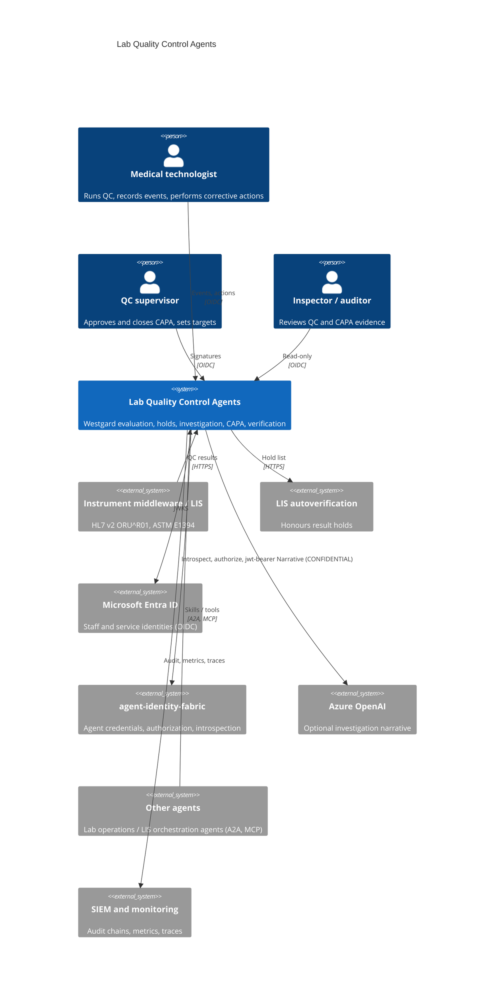
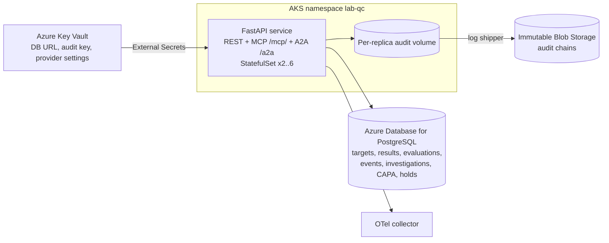
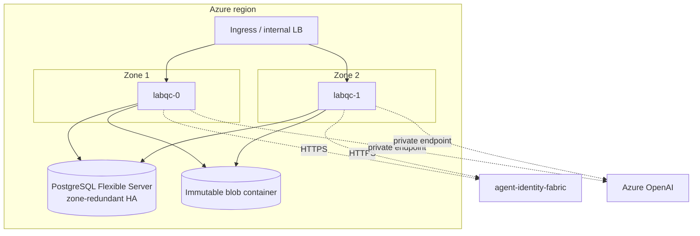

# Architecture

## Business problem

A clinical chemistry analyser runs control materials at two or more
concentrations several times a day. When a control result breaks a Westgard
rule, the run is rejected and patient results produced since the last good
run may be wrong. Today a technologist notices the rejection on the
analyser or middleware screen, searches maintenance logs, reagent and
calibration records by hand, writes a corrective action on paper or in a
separate quality system, and a supervisor signs it days later. Meanwhile:

- results from a failing method can be released because nothing in the LIS
  knows the method is under investigation;
- the same failure pattern (a reagent lot that drifts, a calibration that
  does not hold) is rediscovered on every shift;
- inspectors (CAP, state, ISO 15189 assessors) ask for evidence linking the
  QC failure, the investigation, the corrective action, its verification and
  the patient-result review, and that evidence is scattered.

This service closes the loop: deterministic QC evaluation, an automatic
release hold, agent-assisted root cause analysis, a CAPA record that a
supervisor signs, verification run rules, and a signed audit trail.

## System context (C4 level 1)



## Containers (C4 level 2)



## Components (C4 level 3)

| Layer | Module | Responsibility |
|---|---|---|
| API | `api.routes`, `api.app` | REST contract, correlation IDs, OAuth-style errors, metrics |
| API | `api.mcp_server` | MCP tools over streamable HTTP (official SDK `MCPServer`) |
| API | `api.a2a` | Agent card, JSON-RPC `message/send` skill routing |
| Application | `application.service` | Ingestion, evaluation, holds, targets, statistics, CAPA signatures |
| Application | `application.narrative` | Model narrative behind `ModelRouter` + `ContentGuard` + grounding check |
| Orchestration | `orchestration.agents` | Investigation, corrective action and verification agents; workflow |
| Domain | `domain.westgard`, `statistics`, `investigation`, `capa`, `verification`, `catalog` | QC algorithms and rules, no I/O |
| Integrations | `integrations.hl7`, `astm`, `identity_fabric` | HL7 v2 and ASTM parsing, fabric client |
| Security | `security.authn`, `authz`, `jwks` | OIDC/fabric authentication, ABAC (agentic-core PolicyEngine) |
| Infrastructure | `infrastructure.database` | SQLAlchemy Core repositories |
| Runtime | `runtime.container` | Composition root |

## Sequences

### QC event to CAPA proposal

```mermaid
sequenceDiagram
  participant M as Middleware / LIS
  participant S as QC service
  participant W as Westgard engine
  participant I as Investigation agent
  participant F as Identity fabric
  participant C as Corrective action agent
  M->>S: POST /v1/qc/hl7 (ORU^R01, SPM-11=Q)
  S->>S: refuse PID identifiers / patient specimens
  S->>S: map LOINC -> analyte, match target (material, lot, units), z-score
  S->>W: current run + history since last reset (rejected runs excluded)
  W-->>S: reject: 2_2s within run (systematic)
  S->>S: place hold (analyte, instrument); audit
  S->>F: jwt-bearer (projected SA token) -> agent credential
  S->>I: investigate(evaluation)
  I->>F: /v1/authorize investigation:run
  I->>I: events, lot changes, cross-analyte failures, calibration age -> ranked hypotheses
  I-->>S: investigation (+ optional narrative)
  S->>C: propose(investigation)
  C->>F: /v1/authorize capa:propose
  C-->>S: CAPA status=proposed (needs supervisor signature)
  S-->>M: IngestReport + HL7 ACK (AA)
```

### Signatures, verification, release

```mermaid
sequenceDiagram
  participant Sup as Supervisor
  participant T as Technologist
  participant S as QC service
  participant V as Verification agent
  Sup->>S: POST /v1/capas/{id}/approve (statement)  [not the proposer]
  S-->>Sup: approved; signature = signer, time, meaning, record digest
  T->>S: POST /v1/capas/{id}/complete-action (note)
  Note over S: rule history restarts at the action time
  T->>S: verification QC runs (HL7/ASTM)
  S->>V: on each run: verify(capa)
  V-->>S: verified (complete runs, |z|<=2, no rule, bias removed)
  Sup->>S: POST /v1/capas/{id}/close  [not the performer]
  S->>S: release hold; audit
```

## Deployment view



Azure is the reference deployment: AKS with Workload Identity, Azure Database
for PostgreSQL Flexible Server (zone-redundant), Key Vault (RBAC, purge
protection, private), immutable Blob Storage for audit chains. The same chart
runs on EKS (RDS, Secrets Manager, S3 Object Lock, IRSA) and GKE (Cloud SQL,
Secret Manager, retention-locked GCS, Workload Identity); Terraform for all
three is in `deployments/terraform`.

## Data

| Store | Data | Classification | Retention |
|---|---|---|---|
| `qc_targets` | Control material targets and rule selection | INTERNAL | Life of lot + 2 years (CLIA 493.1105) |
| `qc_results`, `qc_evaluations` | Control measurements, z-scores, rule outcomes | INTERNAL | 2 years minimum; laboratory policy may require longer |
| `instrument_events` | Calibration, maintenance, lot changes, faults | INTERNAL | As above |
| `investigations`, `capas` | RCA, CAPA, electronic signatures | CONFIDENTIAL | As above |
| `qc_holds` | Release holds | INTERNAL | As above |
| Audit chains | Every decision and state change | CONFIDENTIAL | 7 years, immutable |

No patient data enters the system: messages with patient identifiers or
non-control specimens are refused, and policy denies anything classified
RESTRICTED.

## MCP integration

`/mcp/` serves the official MCP Python SDK (`MCPServer`, streamable HTTP,
stateless, JSON responses) so it scales horizontally behind a load balancer.
Tools: `evaluate_qc_run`, `levey_jennings`, `sigma_metric`,
`get_investigation`, `get_capa`, `list_holds`, each with typed input and
output schemas. The bearer token on the MCP request is authenticated and the
call is authorized by the same policy as REST, then audited. Host headers are
restricted (`LABQC_MCP_ALLOWED_HOSTS`) against DNS rebinding. There are no
tools for signatures.

## A2A communication

`/.well-known/agent-card.json` advertises skills `qc.evaluate_run`,
`qc.ingest_hl7`, `qc.ingest_astm`, `qc.investigation` and `qc.holds` with an
HTTP bearer security scheme. `POST /a2a` implements JSON-RPC 2.0
`message/send`: a `data` part with `skill` selects a skill explicitly; HL7 or
ASTM text parts are recognised. Tasks complete synchronously (`completed`,
`rejected` for policy refusals, `failed` for domain errors) with results as a
`data` artifact. Authentication happens at the HTTP layer (401).

## Observability

Prometheus metrics (`/metrics`, own registry): request latency by route,
results ingested and unmatched, refused messages, run outcomes, rule
violations, investigations by cause, CAPA transitions, narrative outcomes,
active holds, MCP/A2A calls. OpenTelemetry traces (FastAPI instrumentation,
GenAI attributes from the agentic-core router observer) to OTLP. JSON logs
with correlation IDs. Alert rules in `configs/prometheus/alerts.yaml`,
dashboard in `configs/grafana/`.

## CI/CD

GitHub Actions `ci.yml`: ruff, black, mypy `--strict`, bandit, contract
drift, pytest (unit, security, chaos, performance, e2e; coverage gate 90%)
on Python 3.12 and 3.13; PostgreSQL integration job; Helm lint/render with a
required-values failure check, kubeconform, Terraform fmt/validate for three
clouds, Trivy config scan; container build, read-only smoke test (readiness,
agent card, MCP tool list, 401 without a token), Trivy image scan, Syft SBOM,
Grype gate; Semgrep. `release.yml` on `v*.*.*`: quality gate, version
checks, image to GHCR with SBOM and provenance attestation, Helm chart to
GHCR OCI, GitHub release.

## Cost and scalability

The hot path is CPU-light: a Westgard evaluation over 200 history points
takes well under a millisecond, parsing an HL7 or ASTM message under one
millisecond (budgets in `tests/performance`). As a sizing example, 300
analyte/instrument pairs running two control levels four times a day give
2,400 control results and 1,200 run evaluations per day; even if they arrive
in bursts at shift start this is a few requests per second, so two replicas
with 250m CPU each cover it with headroom; the HPA scales to six for
interface catch-up after an outage. PostgreSQL is the main fixed cost
(general purpose 4 vCore zone-redundant in the reference). Model narratives
are optional and bounded to one request of at most 400 output tokens per
rejected run; with a rejection rate of a few percent that is tens of
requests per day.

## Acceptance criteria

1. Westgard rules reproduce the worked examples in `docs/architecture/qc-methods.md` (`tests/unit/test_westgard.py`).
2. A rejected run places a hold before any agent runs; agent or model failure never removes it (`tests/chaos`).
3. No agent or service identity can approve, reject, close or complete a CAPA (`tests/security::test_t2`).
4. The proposer cannot approve and the performer cannot close (`tests/unit/test_service.py`, `tests/security::test_t3`).
5. A CAPA closes only after verification passes; closure lifts the hold (`tests/e2e/test_http_lifecycle.py`).
6. Messages with patient identifiers are refused with an HL7 AR acknowledgement (`tests/security::test_t1`).
7. Every decision and state change is in a verifiable signed audit chain (`tests/security::test_t8`).
8. No generated API input produces a 5xx (`tests/e2e/test_api_contract.py`).
